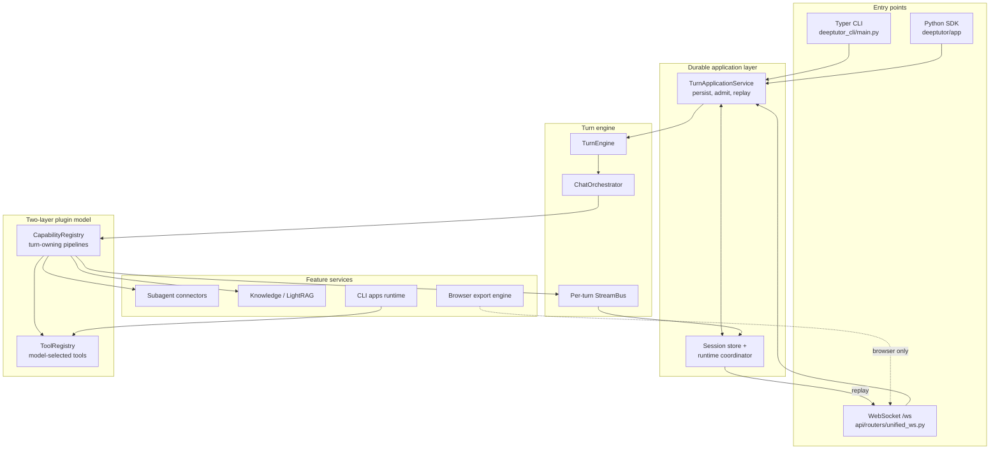
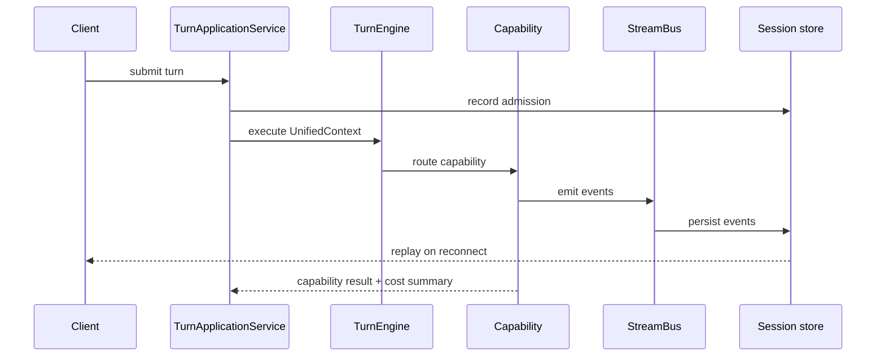
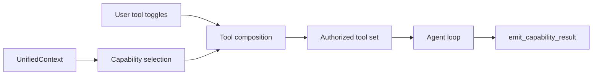
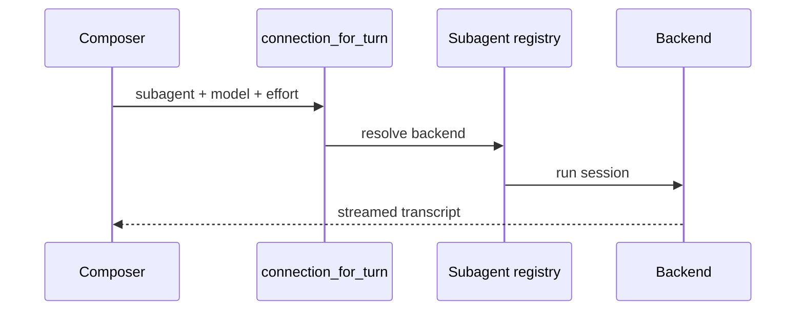
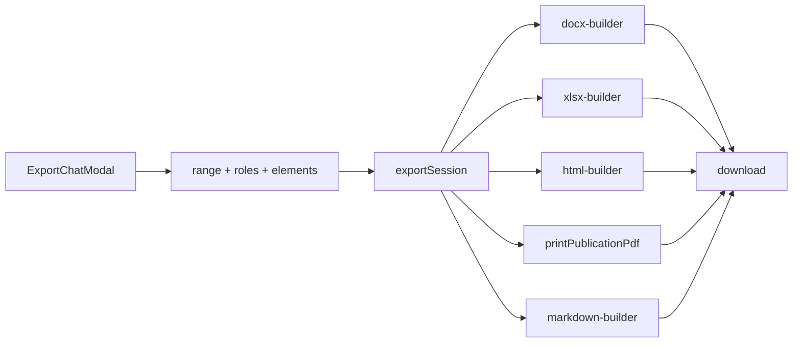
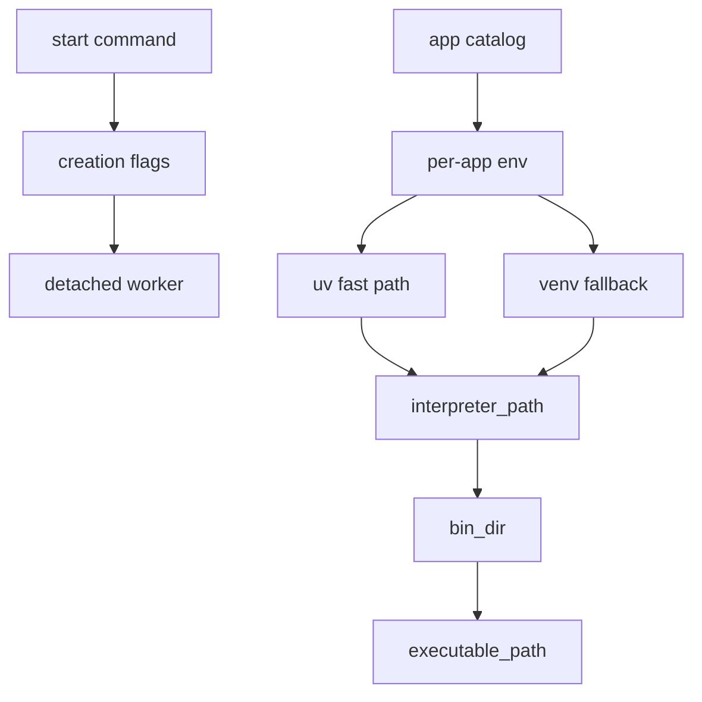

# System Architecture (`ARCHITECTURE.md`)
> **1-Line Summary:** Plain-English visual map of how DeepTutor works, why each layer exists, and step-by-step recipes for changing it safely.

## 1. High-Level Visual System Map

The important invariant: entry points never instantiate an orchestrator directly. Persistence, submission identity, cancellation, replay, and recovery belong to the shared application/runtime path.

## 2. Tech Stack & Why We Chose It

| Layer | Tool / Library | Plain-English Reason Why |
| --- | --- | --- |
| Backend runtime | Python 3.12–3.14 | The upstream project targets these versions; the local venv is 3.12 on Windows. |
| API / streaming | FastAPI + uvicorn + WebSocket | One process serves REST and the unified turn socket, so replay and auth share a boundary. |
| CLI | Typer | Thin commands that call the same application service as the web app. |
| Frontend | Next.js 16 + React 19 | App Router pages compose feature slices; the dependency rules forbid cycles and upward imports. |
| Styling | Tailwind-style tokens + CSS variables | Light/dark themes must keep WCAG contrast without inverting text. |
| Desktop | Electron shell in `apps/desktop/` | Ships the same core without a separate UI implementation. |
| Export | Pure TypeScript builders, zero runtime deps | Runs in the browser, survives upstream Python changes, and needs no server or API key. |
| Knowledge graph | Local LightRAG | Keeps embeddings and graph data on the learner's machine. |
| Tests | pytest, Vitest, Playwright, dependency-cruiser | Each layer has its own fast check; the web check runs without a backend. |

## 3. Core Subsystems & Engineering Tricks

### [SUBSYSTEM: Durable Turn Execution] | Aliases: turn service, replay, reconnect, session recovery, stream bus
> **1-Line Summary:** A turn is admitted once, executed once, persisted as events, and replayed to any adapter that attaches later.

* **How It Works (Plain English):** The CLI, socket, or SDK submits a request to `TurnApplicationService`. The service records the turn, asks `TurnEngine` to route the `UnifiedContext`, and lets `ChatOrchestrator` pick a capability. The capability emits events onto a per-turn `StreamBus`; the runtime stores them as it goes. A reconnecting client asks for the same turn and receives the stored events instead of a second model call.
* **Data Flow Diagram:**

* **Code Anchors (Grep Targets):**
  * `deeptutor/app/service.py` -> `TurnApplicationService`
  * `deeptutor/runtime/turn_engine.py` -> `TurnEngine`
  * `deeptutor/runtime/orchestrator.py` -> `ChatOrchestrator`
  * `deeptutor/runtime/stream_bus.py` -> `StreamBus`
  * `deeptutor/core/context.py` -> `UnifiedContext`

### [SUBSYSTEM: Capability and Tool Composition] | Aliases: tools vs capabilities, plugin model, mount flags, registry
> **1-Line Summary:** A tool is one function the model may call; a capability owns the whole turn and decides which tools are mounted.

* **How It Works (Plain English):** `CapabilityRegistry` maps a normalized context to one turn-owning capability. `ToolRegistry` exposes single operations. The shared composition module turns context, user toggles, and capability requirements into a `ToolMountFlags` set, so a sensitive tool cannot appear merely because the model asked for it.
* **Data Flow Diagram:**

* **Code Anchors (Grep Targets):**
  * `deeptutor/runtime/registry/` -> tool and capability registries
  * `deeptutor/tools/builtin/__init__.py` -> `USER_TOGGLEABLE_TOOL_NAMES`
  * `deeptutor/agents/_shared/tool_composition.py` -> `ToolMountFlags`
  * `deeptutor/agents/_shared/capability_result.py` -> `emit_capability_result`

### [SUBSYSTEM: Subagent Connectors] | Aliases: Command Code, OpenCode, Antigravity, DeepSeek Harness, handoff
> **1-Line Summary:** External coding agents are adapted behind one backend interface, with per-connection model and reasoning-effort settings.

* **How It Works (Plain English):** Each backend owns its process or HTTP transport, session creation, transcript parsing, and error mapping. `binding.py` reads the composer's chosen connection and model for the current turn; `model_preferences.py` supplies display names and pin/hide state. A handoff capability copies the chosen model and effort into the delegated request.
* **Data Flow Diagram:**

* **Code Anchors (Grep Targets):**
  * `deeptutor/services/subagent/registry.py` -> backend registry
  * `deeptutor/services/subagent/command_code.py` -> `CommandCodeBackend`
  * `deeptutor/services/subagent/opencode_family.py` -> `OpencodeFamilyBackend`
  * `deeptutor/capabilities/subagent/binding.py` -> `connection_for_turn`
  * `deeptutor/services/subagent/model_preferences.py` -> `load_model_preferences`

### [SUBSYSTEM: Browser Export Pipeline] | Aliases: docx, xlsx, pdf, html, markdown, export modal
> **1-Line Summary:** The export modal gathers scope and element choices, then pure TypeScript builders assemble downloadable files without a server.

* **How It Works (Plain English):** `ExportChatModal` collects message range, role filters, and element toggles. `exportSession` normalizes the conversation into an export model and calls the requested builder. Word output is a hand-built OOXML zip with native tables and OMML equations; Excel is a real workbook with one sheet per table; HTML is standalone; PDF uses the browser print engine for vector text and pagination.
* **Data Flow Diagram:**

* **Code Anchors (Grep Targets):**
  * `web/features/export/ExportChatModal.tsx` -> `ExportChatModal`
  * `web/lib/export/exporter.ts` -> `exportSession`, `printPublicationPdf`
  * `web/lib/export/docx-builder.ts` -> `buildDocx`, `wordTable`
  * `web/lib/export/html-builder.ts` -> `buildPublicationHtml`
  * `web/lib/latex-normalize.ts` -> `wrapBareEnvironments`

### [SUBSYSTEM: Windows Runtime and CLI Apps] | Aliases: detached launcher, CREATE_NO_WINDOW, venv, uv, npm shims
> **1-Line Summary:** Windows needs explicit creation flags and platform-specific executable directories; both are centralized so install and launch cannot disagree.

* **How It Works (Plain English):** `_launch_detached` spawns a worker with `CREATE_NEW_PROCESS_GROUP | CREATE_NO_WINDOW`, using a `getattr` fallback for platforms whose `subprocess` lacks the constant. CLI apps install into one environment per app. `interpreter_path` and `bin_dir` share `_env_bin_dir`, so the interpreter used for `pip` and the directory entry points are written to always match. Windows Node prefixes are special-cased because npm writes `.cmd` shims at the prefix root, not under `bin/`.
* **Data Flow Diagram:**

* **Code Anchors (Grep Targets):**
  * `deeptutor/runtime/launcher.py` -> `_launch_detached`, `_spawn`, `DETACHED_WORKER_ENV`
  * `deeptutor/services/cli_apps/installer.py` -> `_steps`
  * `deeptutor/services/cli_apps/paths.py` -> `interpreter_path`, `bin_dir`, `executable_path`

### [SUBSYSTEM: Documentation and Agent Protocol] | Aliases: PRODUCT.md, ARCHITECTURE.md, traps, aliases, search-first docs
> **1-Line Summary:** Documentation is a grep-friendly knowledge base with self-descriptive headers, so an agent reads only what the current task needs.

* **How It Works (Plain English):** Every documented item starts with a typed slug plus everyday aliases and a one-line summary. Agents scan headers and summaries first, then open only the matching section. Code is referenced by path and symbol, never by line number, because line numbers rot with every merge.
* **Code Anchors (Grep Targets):**
  * `docs/PRODUCT.md` -> feature intent
  * `docs/ARCHITECTURE.md` -> subsystem mechanics
  * `docs/DECISIONS_AND_TRAPS.md` -> pivots and landmines
  * `AGENTS.md` -> operating protocol and project map

## 4. Verification & Health Checks

### [VERIFY: Local Check Suite] | Aliases: tests, typecheck, compile, lint, pre-commit
> **1-Line Summary:** The minimum commands that must pass before committing a change to this fork.

* **Python syntax check:** `.venv/Scripts/python.exe -m compileall -q deeptutor deeptutor_cli`
* **Frontend type check:** `cd web && npm run typecheck`
* **Full frontend gate:** `cd web && npm run check:fast`
* **Python tests:** `.venv/Scripts/python.exe -m pytest -q` (requires the `dev` extras; not currently installed)
* **Lint / format:** `ruff check .` and `ruff format --check .` (requires the `dev` extras)
* **Repository hygiene:** `python scripts/check_repo_hygiene.py`

## 5. Recipes: How to Add New Things Safely

* **To add a capability:**
  1. Create `deeptutor/capabilities/<name>/capability.py` with its manifest and stages.
  2. Register it in `deeptutor/runtime/bootstrap/builtin_capabilities.py`.
  3. Add prompts under `deeptutor/capabilities/prompts/{en,zh}/<name>.yaml`.
  4. Emit the shared envelope through `emit_capability_result`.
  5. Add a focused test and run the Python syntax check.

* **To add a tool:**
  1. Implement `BaseTool` and `ToolDefinition`.
  2. Register it in `deeptutor/tools/builtin/__init__.py`.
  3. Add it to `USER_TOGGLEABLE_TOOL_NAMES` only if the learner should control it.
  4. Otherwise declare it in `CONFIGURABLE_BUILTIN_TOOL_NAMES` and gate it in `ToolMountFlags`.

* **To add an export format:**
  1. Add a builder under `web/lib/export/` and export it from `index.ts`.
  2. Extend the format union in `web/lib/export/types.ts`.
  3. Wire the option into `ExportChatModal`.
  4. Run `cd web && npm run typecheck`.

* **To add a subagent backend:**
  1. Implement `SubagentBackend` in `deeptutor/services/subagent/`.
  2. Register it in `registry.py` and add model options in `models.py`.
  3. Normalize effort values before they reach the process.
  4. Verify a real session, not only an import.

* **To sync a new upstream release:**
  1. `git fetch upstream --tags`
  2. `git switch -c sync/vX.Y.Z`
  3. `git merge --no-commit vX.Y.Z`
  4. Resolve collisions in favour of local behavior, then ask the human about genuine product choices.
  5. Run the check suite above, commit, fast-forward `main`, and push to `origin`.
