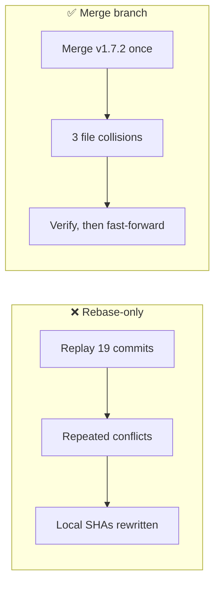
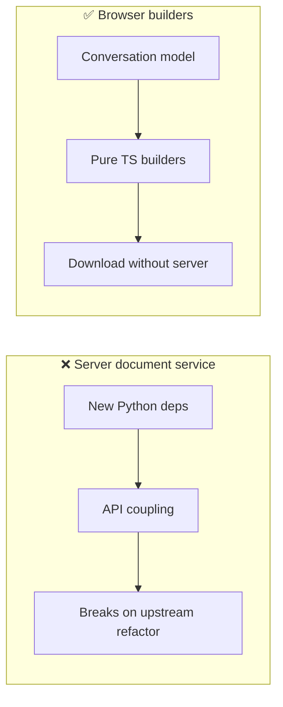
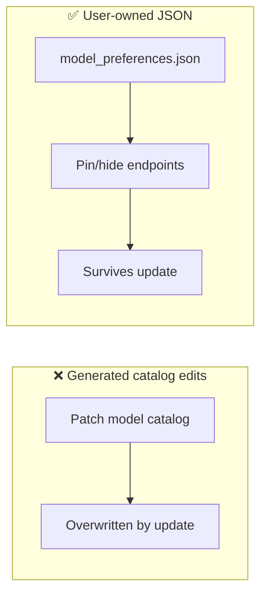
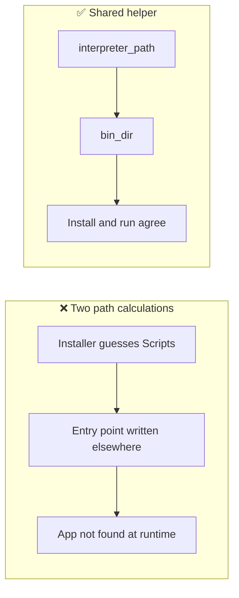
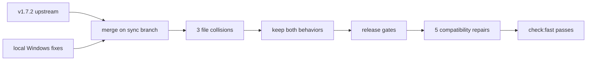
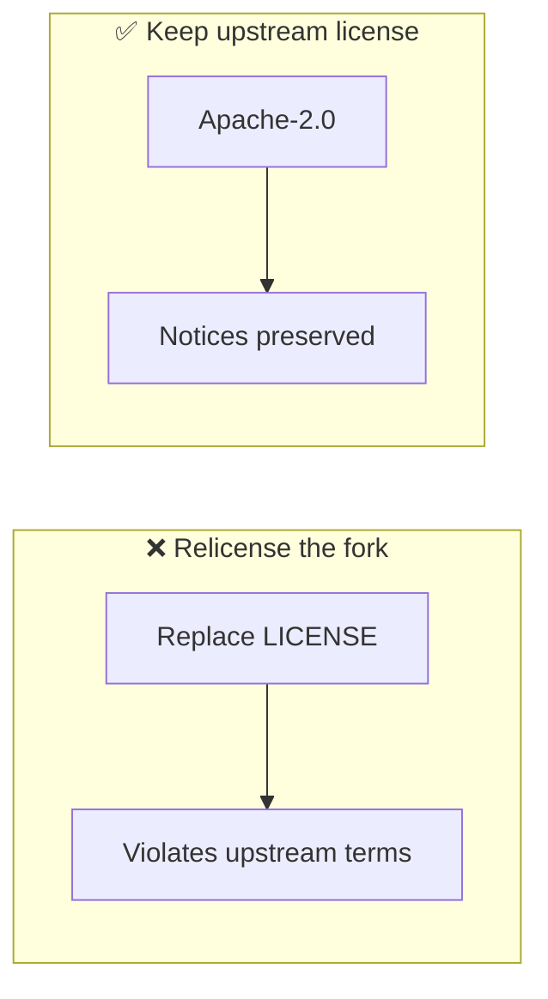
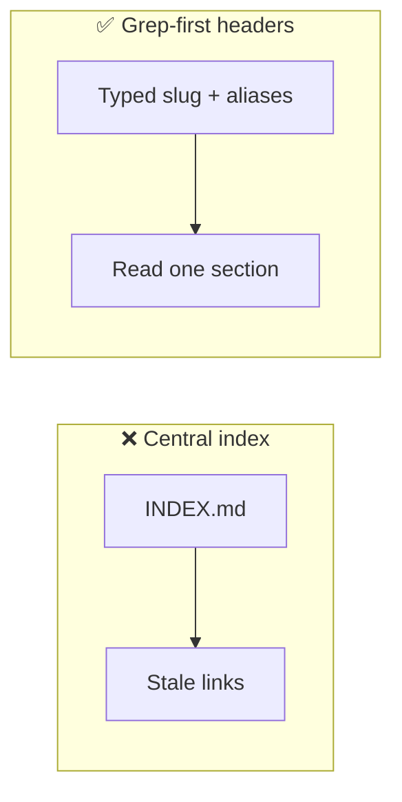

# Architectural Decisions, Pivots & Landmines (`DECISIONS_AND_TRAPS.md`)
> **1-Line Summary:** Records why this fork chose its approaches, what failed, who decided, and which code must never be "simplified" back into a bug.

## 1. Architectural Decisions & Pivot History

### [DECISION: Fork-and-Merge Instead of Rebase] | Aliases: upstream sync, v1.7.2, custom commits, history preservation
> **1-Line Summary:** Official releases are merged into the fork on a dedicated branch, never rebased over, so the 19 local commits stay intact and auditable.
* **Decision Maker:** `[DECIDED BY: HUMAN]`
* **Original User Intention:** Keep every local feature and customization while still receiving official updates.
* **Options Considered:**
  * **Option A (Rejected):** Rebase local commits onto each upstream tag. Cleaner linear history, but every conflict is replayed commit by commit and local SHAs disappear.
  * **Option B (Chosen):** Merge the upstream tag into `sync/vX.Y.Z`, resolve conflicts once, verify, then fast-forward `main`. The merge commit records exactly which side won each collision.
* **Visual Pivot Map (What Failed vs. What Works):**

* **Code Anchors (Grep Targets):**
  * `.git/config` -> `origin`, `upstream`
  * `deeptutor/runtime/launcher.py` -> Windows creation flags
  * `deeptutor/services/cli_apps/paths.py` -> Windows executable resolution

### [DECISION: Browser-Side Zero-Dependency Export] | Aliases: export engine, docx, pdf, offline export
> **1-Line Summary:** Export is implemented as pure TypeScript in the browser instead of server-side document libraries, so it survives backend refactors and needs no extra service.
* **Decision Maker:** `[DECIDED BY: HUMAN]`
* **Original User Intention:** Export any conversation to Word, Excel, PDF, HTML, Markdown, JSON, or text without losing formatting or depending on a server.
* **Options Considered:**
  * **Option A (Rejected):** Server-side `python-docx` / reportlab endpoints. Adds Python dependencies, fights the streaming model, and breaks whenever upstream moves the API.
  * **Option B (Chosen):** Hand-built OOXML zip, real xlsx workbook, standalone HTML, browser print-to-PDF, and Markdown builders in `web/lib/export/`.
* **Visual Pivot Map (What Failed vs. What Works):**

* **Code Anchors (Grep Targets):**
  * `web/lib/export/exporter.ts` -> `exportSession`, `printPublicationPdf`
  * `web/lib/export/docx-builder.ts` -> `buildDocx`
  * `web/lib/export/xlsx-builder.ts` -> workbook builder

### [DECISION: Human-Editable JSON for Model Preferences] | Aliases: pin model, hide model, model_preferences.json
> **1-Line Summary:** Model display names, pins, and hides live in a plain JSON file and a small REST surface, not in a database or generated catalog.
* **Decision Maker:** `[DECIDED BY: HUMAN]`
* **Original User Intention:** Rearrange and declutter the model picker without editing source, and keep those choices across updates.
* **Options Considered:**
  * **Option A (Rejected):** Store preferences in the session database. Survives restarts but not a clean reinstall, and is hard for the learner to inspect.
  * **Option B (Chosen):** `data/user/settings/model_preferences.json`, read by the backend and toggled through `/api/settings/model-preferences/*`.
* **Visual Pivot Map (What Failed vs. What Works):**

* **Code Anchors (Grep Targets):**
  * `deeptutor/services/subagent/model_preferences.py` -> `load_model_preferences`
  * `deeptutor/api/routers/settings.py` -> `/model-preferences/toggle-pin`, `/toggle-hide`
  * `web/components/chat/home/AnswerModeMenu.tsx` -> `ModelPreferenceActions`

### [DECISION: One Interpreter Path for CLI App Installs] | Aliases: uv, venv, pip, Windows Scripts, interpreter_path
> **1-Line Summary:** Installation always resolves the environment's interpreter through one shared helper, whether the environment was created by `uv` or by the stdlib `venv`.
* **Decision Maker:** `[DECIDED BY: AGENT — reviewed in the v1.7.2 merge]`
* **Original User Intention:** Local CLI apps must install and run on Windows, including when `uv` is present.
* **Options Considered:**
  * **Option A (Rejected):** Compute the interpreter inline in the installer. It drifted from `bin_dir`, so pip could install into one directory while the app looked in another.
  * **Option B (Chosen):** `interpreter_path()` and `bin_dir()` share `_env_bin_dir()`, with the uv fast path still using the same resolved interpreter.
* **Visual Pivot Map (What Failed vs. What Works):**

* **Code Anchors (Grep Targets):**
  * `deeptutor/services/cli_apps/paths.py` -> `_env_bin_dir`, `interpreter_path`, `bin_dir`
  * `deeptutor/services/cli_apps/installer.py` -> `_steps`

### [DECISION: v1.7.2 Merge Kept Both Sides] | Aliases: merge record, launcher conflict, installer conflict, paths conflict, compatibility repairs
> **1-Line Summary:** The v1.7.2 merge preserved local Windows behavior and adopted upstream's shared helpers; five custom UI patterns were then adapted to the release gates without changing user-visible behavior.
* **Decision Maker:** `[DECIDED BY: AGENT — reviewed in the v1.7.2 merge]`
* **Original User Intention:** Receive every v1.7.2 feature without losing the fork's launcher, CLI-app, export, subagent, preference, or workspace behavior.
* **Collisions and Resolutions:**

| File | Local behavior | Upstream change | Resolution |
| --- | --- | --- | --- |
| `deeptutor/runtime/launcher.py` | `getattr(subprocess, "CREATE_NO_WINDOW", ...)` so stripped Python builds still launch | Hidden-console launch plus `PYTHONSAFEPATH=1` to avoid stale source-tree imports | Kept the fallback and upstream's other launcher changes |
| `deeptutor/services/cli_apps/installer.py` | `uv` fast path and a Windows venv redirector override | Shared `interpreter_path()` and rollback-backup preservation | Used `interpreter_path()` everywhere; kept the `uv` and redirector branches |
| `deeptutor/services/cli_apps/paths.py` | Windows npm prefix-root `.cmd` / `.bat` probing | Shared `_env_bin_dir()` and deterministic interpreter naming | Adopted the shared helper; kept the Windows prefix-root and extension probing |

* **Compatibility Repairs (No Behavior Change):**

| Area | New gate | Repair |
| --- | --- | --- |
| Model preference toggles | No raw `fetch` outside the shared client | `requestVoid` in `AnswerModeMenu` |
| Hover hints | Native `title` is not accessible enough | Shared `Tooltip` on pin/hide and print controls |
| Prop-to-state sync | React forbids effect-based syncing | Derive the selected model during render |
| API and turn contracts | Generated files must match source | Regenerated under `web/contracts/generated/` |
| Locale keys | Every `t()` key must exist in strict locales | Added 48 export/model keys and `Export`; en/zh translated, others fall back to English |

* **Visual Pivot Map (What Failed vs. What Works):**

* **Code Anchors (Grep Targets):**
  * `deeptutor/runtime/launcher.py` -> `_launch_detached`, `_spawn`
  * `deeptutor/services/cli_apps/installer.py` -> `_steps`
  * `deeptutor/services/cli_apps/paths.py` -> `_env_bin_dir`, `interpreter_path`, `bin_dir`
  * `web/components/chat/home/AnswerModeMenu.tsx` -> model preference toggles
  * `web/shared/api/client.ts` -> `requestVoid`
  * `web/shared/ui/Tooltip.tsx` -> `Tooltip`
  * `web/scripts/generate-contracts.mjs` -> `--check`
  * `web/scripts/i18n_parity.mjs` -> locale key parity

### [DECISION: Apache-2.0 License Stays] | Aliases: licensing, PolyForm, fork license, attribution
> **1-Line Summary:** The fork keeps the upstream Apache-2.0 license because a fork cannot relicense Apache-2.0 code; this is a deliberate exception to the agent protocol's default PolyForm rule.
* **Decision Maker:** `[DECIDED BY: AGENT — flagged to Human]`
* **Original User Intention:** Follow the standard agent protocol, which asks for PolyForm Noncommercial 1.0.0 on personal projects.
* **Options Considered:**
  * **Option A (Rejected):** Replace `LICENSE` with PolyForm Noncommercial. Not legally available for a derivative of Apache-2.0 code, and it would strip rights upstream granted.
  * **Option B (Chosen):** Keep Apache-2.0, preserve upstream notices, and record third-party credits in `THIRD_PARTY_NOTICES.md`.
* **Visual Pivot Map (What Failed vs. What Works):**

* **Code Anchors (Grep Targets):**
  * `LICENSE` -> Apache License 2.0
  * `THIRD_PARTY_NOTICES.md` -> attribution table
  * `CITATION.cff` -> upstream citation

### [DECISION: Search-First Documentation, No Index File] | Aliases: aliases, one-line summary, grep docs, doc blueprint
> **1-Line Summary:** Documentation uses typed slug headers, everyday aliases, and a one-line summary instead of a central index, so agents can grep before reading.
* **Decision Maker:** `[DECIDED BY: HUMAN]`
* **Original User Intention:** Stop agents from bulk-reading the docs folder and burning context on irrelevant pages.
* **Options Considered:**
  * **Option A (Rejected):** A hand-maintained `INDEX.md`. It goes stale and still requires a full read to find the right page.
  * **Option B (Chosen):** `### [TYPE: Slug] | Aliases: ...` plus `> **1-Line Summary:**` on the next line, with symbol anchors instead of line numbers.
* **Visual Pivot Map (What Failed vs. What Works):**

* **Code Anchors (Grep Targets):**
  * `docs/PRODUCT.md` -> feature intent
  * `docs/ARCHITECTURE.md` -> subsystem map
  * `AGENTS.md` -> protocol and project map

---

## 2. Do-Not-Touch Engineering Landmines (Traps)

### [TRAP: Taking Upstream Wholesale in Custom Subsystems] | Aliases: merge conflict, export deleted, subagent lost, model picker reverted
> **1-Line Summary:** NEVER resolve a merge in `web/lib/export/`, `web/features/export/`, `deeptutor/services/subagent/`, or the model-preference routes by accepting upstream without comparing local behavior.
* **Strict Rule:** **NEVER** run `git checkout --theirs` across those paths. Resolve file by file, and keep the local implementation unless the human explicitly chooses upstream.
* **Why This Trap Exists (Plain English):** Upstream has no knowledge of this fork's export engine, extra backends, or pin/hide preferences. Git can merge them cleanly and still leave a caller pointing at the old shape.
* **Protected Code Anchors (Grep Targets):**
  * `web/lib/export/exporter.ts` -> `exportSession`, `printPublicationPdf`
  * `deeptutor/services/subagent/model_preferences.py` -> `load_model_preferences`
  * `deeptutor/services/subagent/registry.py` -> backend registry

### [TRAP: Windows npm Shims Live at the Prefix Root] | Aliases: npm, .cmd, bin_dir, CLI app not found
> **1-Line Summary:** NEVER collapse Windows Node resolution back to `<prefix>/bin`; npm writes `.cmd` shims at the prefix root there.
* **Strict Rule:** **NEVER** remove the `AppRuntime.NODE` + `os.name == "nt"` branch in `bin_dir`, or the `.cmd` / `.bat` probing in `executable_path`.
* **Why This Trap Exists (Plain English):** POSIX npm uses `bin/`, Windows npm uses the prefix root plus `.cmd` and `.bat` shims. A single "clean" helper that assumes `bin/` makes every Windows CLI app look missing.
* **Protected Code Anchors (Grep Targets):**
  * `deeptutor/services/cli_apps/paths.py` -> `bin_dir`, `executable_path`

### [TRAP: Duplicate Interpreter Path Math] | Aliases: pip installed nowhere, venv Scripts, uv, CLI app install
> **1-Line Summary:** NEVER compute the venv interpreter inline again; `interpreter_path()` and `bin_dir()` must share one calculation.
* **Strict Rule:** **NEVER** reintroduce a local `python_in_venv`-style path expression in `installer.py`. Call `interpreter_path(env_dir)`.
* **Why This Trap Exists (Plain English):** The installer and the runtime resolve entry points independently. If their path math differs by one directory, installation reports success and execution fails later, usually on a learner's machine.
* **Protected Code Anchors (Grep Targets):**
  * `deeptutor/services/cli_apps/installer.py` -> `_steps`
  * `deeptutor/services/cli_apps/paths.py` -> `interpreter_path`

### [TRAP: Treating .env as Application Configuration] | Aliases: dotenv, settings, runtime config, missing key
> **1-Line Summary:** NEVER add `.env` loading as a configuration source; runtime settings belong in `data/user/settings/`.
* **Strict Rule:** **NEVER** make a feature depend on a project-root `.env` value. Use the runtime settings service, and keep `.env` out of version control.
* **Why This Trap Exists (Plain English):** The project deliberately ignores `.env` at runtime. A feature that reads it works on the developer's machine and silently fails for every packaged install, where no such file exists.
* **Protected Code Anchors (Grep Targets):**
  * `deeptutor/services/config/runtime_settings.py` -> runtime settings
  * `.gitignore` -> `.env`, `data/`

### [TRAP: Re-Wrapping Already-Normalized LaTeX] | Aliases: KaTeX parse error, matrix, aligned, cascading formula failure
> **1-Line Summary:** NEVER wrap a LaTeX environment that is already wrapped; the normalizer must be idempotent or one bad delimiter breaks every later formula.
* **Strict Rule:** **NEVER** change `wrapBareEnvironments` to wrap unconditionally, and never remove the delimiter scan that finds the true closing `\end`.
* **Why This Trap Exists (Plain English):** KaTeX fails the whole render when delimiters nest incorrectly. A matrix inside `$$...$$` that gets wrapped a second time produces a parse error that cascades through the message, hiding correct formulas below it.
* **Protected Code Anchors (Grep Targets):**
  * `web/lib/latex-normalize.ts` -> `wrapBareEnvironments`
  * `web/lib/export/exporter.ts` -> `printPublicationPdf`

### [TRAP: Assuming CREATE_NO_WINDOW Exists] | Aliases: Windows launcher, console flash, subprocess constant, detached worker
> **1-Line Summary:** NEVER replace the `getattr(subprocess, "CREATE_NO_WINDOW", ...)` fallback with a direct attribute access.
* **Strict Rule:** **NEVER** remove the fallback, even though it looks redundant on a normal Windows install.
* **Why This Trap Exists (Plain English):** The constant is Windows-only and is absent on some embedded or stripped Python builds. A direct access raises `AttributeError` at launch, so the app fails to start with a traceback instead of a clear platform message.
* **Protected Code Anchors (Grep Targets):**
  * `deeptutor/runtime/launcher.py` -> `_launch_detached`

### [TRAP: Line Numbers as Documentation Anchors] | Aliases: stale docs, grep target, doc drift
> **1-Line Summary:** NEVER cite a line number in documentation; every merge shifts it and the reference silently points at unrelated code.
* **Strict Rule:** **NEVER** write a file path followed by a line number. Write the path and the function, class, or variable name instead.
* **Why This Trap Exists (Plain English):** The v1.7.2 merge moved hundreds of lines. A line-number anchor that was correct yesterday now points into a different function, which is worse than no anchor because it looks trustworthy.
* **Protected Code Anchors (Grep Targets):**
  * `docs/PRODUCT.md` -> all `Code Anchors` blocks
  * `docs/ARCHITECTURE.md` -> all `Code Anchors` blocks
