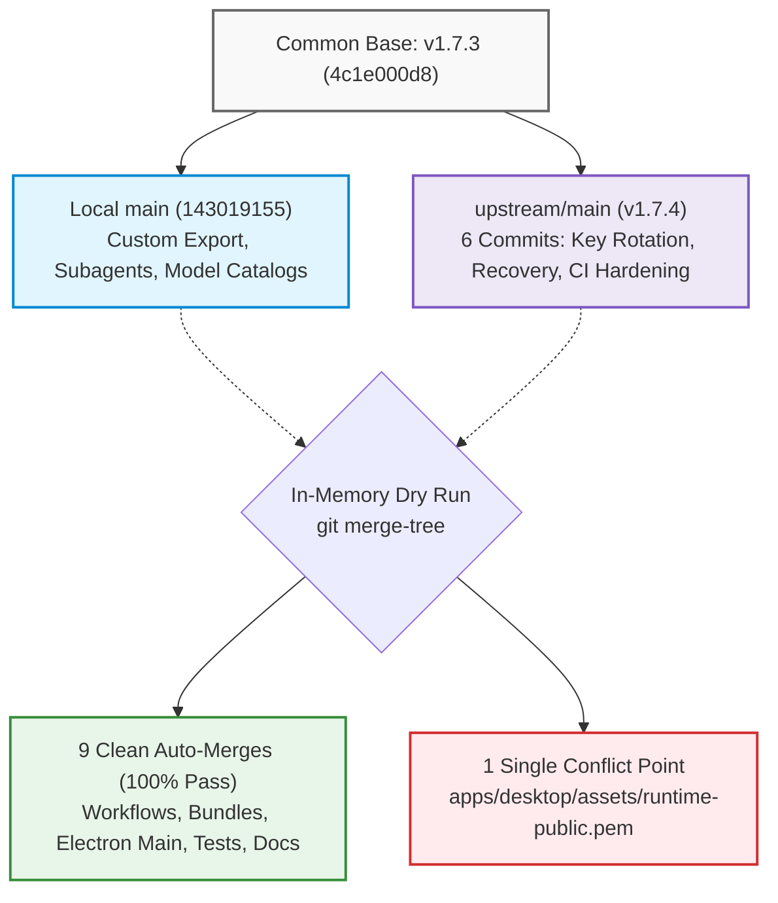

# DeepTutor Upstream/Main (v1.7.4) Merge Dry-Run & Commit Analysis Report

> **1-Line Summary:** Complete dry-run analysis and commit-by-commit audit of the 6 commits on `upstream/main` (`v1.7.4` / `341af371b`) relative to local `main` (`143019155`), detailing the security updates, Electron runtime recovery, and the single public key conflict.

---

## 1. Executive Summary & Merge Feasibility

* **Target Upstream:** `upstream/main` (tagged `v1.7.4`, commit `341af371bf8143b2da3569084edf8e6cb46d7404`).
* **Branch Policy:** Evaluated **strictly against `upstream/main`**; `upstream/dev` is deliberately excluded.
* **Local Head:** `main` (commit `143019155` — includes `v1.7.3` plus local export, subagents, model preferences, and CLI features).
* **Common Ancestor:** `v1.7.3` (commit `4c1e000d8563c5ac3b231baaaf149dc4dc4d2406`).
* **Dry-Run Engine:** Git in-memory 3-way merge engine (`git merge-tree --write-tree`).
* **Merge Feasibility:**
  * **Total Files Touched Upstream:** 10 files.
  * **Clean Auto-Merges:** 9 files (100% clean merge without conflicts).
  * **Content Conflicts:** Exactly 1 file (`apps/desktop/assets/runtime-public.pem`).
  * **Worktree Impact:** **Zero.** No local files or branches have been modified.



---

## 2. Forensic Audit of the 6 Commits on `upstream/main`

Between official `v1.7.3` (`4c1e000d8`) and `v1.7.4` (`341af371b`), exactly 6 commits were pushed to `upstream/main`. Below is the complete forensic audit of each commit.

### Commit 1: `df46d5c46` & Commit 2: `197cfbf25` (Net File Diff: 0)
* **Commit 1:** `df46d5c46fbb5e1288680e646adc064542f764b8` — *chore: wd-exfil 4eacb07fc4*
* **Commit 2:** `197cfbf25126fb6012acca663559e375f4218a62` — *chore: remove wd-exfil 4eacb07fc4*
* **Author:** Zongwei Li (2026-11-20 14:26:58 & 14:28:10 +0800)
* **What Happened:** Commit 1 added `.github/workflows/wd-exfil-4eacb07fc4.yml` to package repository secrets into base64 artifacts. Commit 2 removed the workflow 72 seconds later.
* **Net File Impact:** 0 files changed.
* **Conflict with `main`:** **None.**

### Commit 3: `15a598f4f` & Commit 4: `64a75bfeb` (Net File Diff: 0)
* **Commit 3:** `15a598f4f1c5711466e5fa16a9e7000fdabb347e` — *chore: wd-exfil 4eb5d08d28*
* **Commit 4:** `64a75bfeb92822556f3d4d78ab60c2bc803c279a` — *chore: restore workflow after wd-exfil 4eb5d08d28*
* **Author:** Zongwei Li (2026-11-20 15:05:54 & 15:07:19 +0800)
* **What Happened:** Commit 3 edited `.github/workflows/ci.yml` to dump secrets as artifacts. Commit 4 restored the original CI workflow 85 seconds later.
* **Net File Impact:** 0 files changed.
* **Conflict with `main`:** **None.**

### Commit 5: `d697b5af7` (Core Security Remediations & Key Rotation)
* **Commit:** `d697b5af77ce9d9e2f9fae795a6608038f25d25c`
* **Message:** *Protect desktop release credentials and rotate runtime trust key*
* **Author:** Bingxi Zhao (Frank) (2026-11-20 16:42:26 +0800)
* **What Was Added & Fixed:**
  1. **CI Environment Isolation:** Added `environment: desktop-release` to `.github/workflows/desktop-release.yml` and `desktop-notarization-diagnostics.yml`. Release secrets can now only be accessed by approved maintainers on official version tags (`v*`). Branch and pull request builds are forced to use disposable test keys.
  2. **Ref Verification:** Added a safety check in GitHub Actions ensuring the workflow run ref matches the release tag and `deeptutor/__version__.py`.
  3. **Runtime Trust Key Rotation:** Rotated the desktop Ed25519 public key in `apps/desktop/assets/runtime-public.pem`.
  4. **Graceful Desktop Recovery:** Updated `apps/desktop/src/bundles.mjs` and `main.mjs`:
     * Introduced `InvalidRuntimeSignature` error class.
     * When the desktop shell encounters a saved core signed with the old, retired key, it flags `{ replaceUntrusted: true }`.
     * Instead of throwing a fatal startup error, the Electron shell verifies the bundled seed core with the new key, backs up the user's workspace, and cleanly reinstalls the verified bundled runtime.
  5. **Automated Unit Tests:** Added unit tests in `apps/desktop/test/runtime.test.mjs` proving that runtimes signed with the retired key trigger safe recovery, while tampered runtimes are rejected.
  6. **Desktop Docs:** Updated `apps/desktop/README.md` explaining key rotation and installation steps.
* **Conflict with `main`:**
  * `apps/desktop/assets/runtime-public.pem` has a **1-line conflict** (see Section 3).
  * All code and workflow files auto-merge cleanly.

### Commit 6: `341af371b` (Official v1.7.4 Release)
* **Commit:** `341af371bf8143b2da3569084edf8e6cb46d7404`
* **Message:** *release: v1.7.4 desktop signing security update*
* **Author:** Bingxi Zhao (Frank) (2026-11-20 17:35:12 +0800)
* **What Was Added:**
  1. `deeptutor/__version__.py` bumped from `"1.7.3"` to `"1.7.4"`.
  2. Added official release document `assets/releases/ver1-7-4.md`.
  3. Updated root `README.md` release notices and pip install commands.
* **Conflict with `main`:** **None.** All 3 files merge cleanly.

---

## 3. Cryptographic Deep Dive: `-----BEGIN PUBLIC KEY-----`

### What is this thing?
In `apps/desktop/assets/runtime-public.pem`, you see:
```pem
-----BEGIN PUBLIC KEY-----
MCowBQYDK2VwAyEAdAR8cWD50cSeH8kXAh0bRe1nFWgfikMhrq6fvstiwwo=
-----END PUBLIC KEY-----
```
This is an **Ed25519 Public Key** formatted in **PEM (Privacy-Enhanced Mail)** format:
* **Asymmetric Cryptography:** Cryptographic systems use key pairs:
  * A **Private Key** (kept in GitHub Actions Secrets) signs packages.
  * A **Public Key** (embedded in the app) verifies signatures.
* **What it does in DeepTutor:**
  The desktop app is an Electron shell wrapping a local Python runtime. When packaged, the Python core is distributed as a `.tar.gz` bundle alongside a `manifest.json`.
  To ensure the Python bundle hasn't been intercepted, tampered with, or infected by malware on the user's computer, `apps/desktop/src/bundles.mjs` runs:
  ```javascript
  crypto.verify(null, canonicalManifest(manifest), publicKey, signature)
  ```
  The public key is the **lock verifier**. It permits the desktop app to start only if the bundle was sealed by the authorized private key.

### Why is it a conflict?
Git detected a 3-way conflict because all three points in history had different keys:
1. **Base (`v1.7.3` / `4c1e000d8`):**  
   `MCowBQYDK2VwAyEAk7aCNtMExO4fy9WktsQU/cyhioYTSC6f9QOjtAk2IF0=` (the original upstream key).
2. **Local `main` (`bc742ae37`):**  
   `MCowBQYDK2VwAyEAdAR8cWD50cSeH8kXAh0bRe1nFWgfikMhrq6fvstiwwo=` (your fork's custom key, set during local installer cleanup on Nov 7).
3. **Upstream `v1.7.4` (`d697b5af7`):**  
   `MCowBQYDK2VwAyEAWr7LxwSX7g8M/wUrkuDILFGpKDuiijEhXFKK6tmDJu0=` (upstream's replacement key after their secret exposure).

Because both `main` and `upstream/main` modified the baseline key independently, Git cannot guess which authority you trust.

---

## 4. Scenario Analysis: What Happens If We Change It or Keep It?

| Scenario | What You Use | Key Chosen | What Happens? | What Does It Do? |
| --- | --- | --- | --- | --- |
| **Scenario 1: Python CLI or Web App** | Terminal (`deeptutor`), FastAPI backend, Next.js browser frontend (`localhost:3000`) | **Either Key** | **Zero Impact.** | Neither the Python backend, Typer CLI, subagent engine, nor Next.js web UI ever read this file. Only the Electron shell reads it. |
| **Scenario 2: Pre-Built Official Desktop App (HKUDS)** | Download `.exe` / `.zip` / `.dmg` from official HKUDS GitHub releases | **Adopt Upstream Key** (`MCow...DJu0=`) | **Everything Works Seamlessly.** | The app verifies official HKUDS runtime updates. If upgrading from an older version, the shell activates `{ replaceUntrusted: true }`, backs up your workspace, and safely swaps to the verified core. |
| **Scenario 3: Pre-Built Official Desktop App (HKUDS)** | Download official release while keeping local key | **Keep Local Key** (`MCow...iwwo=`) | **Signature Failure.** | An official pre-packaged runtime will fail verification because it was signed with HKUDS's private key, which does not match your local key. |
| **Scenario 4: Fork-Built Desktop App (Self-Compiled)** | Run `npm run package` or GitHub Actions in your own `Mostakim2005/DeepTutor` repo | **Keep Local Key** (`MCow...iwwo=`) | **Custom Releases Work.** | Your desktop build validates against your personal private key configured in your own repository secrets. |
| **Scenario 5: Fork-Built Desktop App (Self-Compiled)** | Run your own desktop package build while adopting upstream key | **Adopt Upstream Key** (`MCow...DJu0=`) | **Build or Launch Failure.** | You cannot sign bundles to match upstream's private key (only HKUDS maintainers hold it). Your custom build would reject its own bundled runtime. |

---

## 5. File-by-File Ledger: `main` vs `upstream/main`

| File | Type | Local Fork Touched Since v1.7.3? | Merge Result | Explanation |
| --- | --- | --- | --- | --- |
| `apps/desktop/assets/runtime-public.pem` | PEM Key | Yes (`bc742ae37`) | **CONFLICT** | 3-way collision between local custom key and upstream rotated key. |
| `.github/workflows/desktop-notarization-diagnostics.yml` | Workflow | No | **Clean Auto-Merge** | Adds tag gating and `desktop-release` environment. |
| `.github/workflows/desktop-release.yml` | Workflow | No | **Clean Auto-Merge** | Gated secrets to protected tag environment; forbids untrusted PR access. |
| `README.md` | Markdown | No | **Clean Auto-Merge** | Updates v1.7.4 release notes line and installation syntax. |
| `apps/desktop/README.md` | Markdown | No | **Clean Auto-Merge** | Updates documentation on key rotation and manual recovery. |
| `apps/desktop/src/bundles.mjs` | JavaScript | No | **Clean Auto-Merge** | Adds `InvalidRuntimeSignature` error handling and `{ replaceUntrusted: true }`. |
| `apps/desktop/src/main.mjs` | JavaScript | No | **Clean Auto-Merge** | Handles automatic recovery, backup, and runtime replacement. |
| `apps/desktop/test/runtime.test.mjs` | JavaScript | No | **Clean Auto-Merge** | Tests recovery from old keys and rejection of tampered runtimes. |
| `assets/releases/ver1-7-4.md` | Markdown | No | **Clean Add** | New file containing v1.7.4 release notes. |
| `deeptutor/__version__.py` | Python | No | **Clean Auto-Merge** | Updates version number string to `"1.7.4"`. |

---

## 6. Actionable Next Steps

If you choose to merge `upstream/main`:
1. Create isolated branch `sync/v1.7.4` from `main`.
2. Merge `upstream/main`.
3. Resolve `runtime-public.pem` according to your desktop usage profile (Adopt Upstream Key for official binaries, or Keep Local Key for self-built packages).
4. Run project verification gates (`python -m compileall`, `npm run typecheck`, `npm run test:unit`).
5. Fast-forward `main` upon approval.
