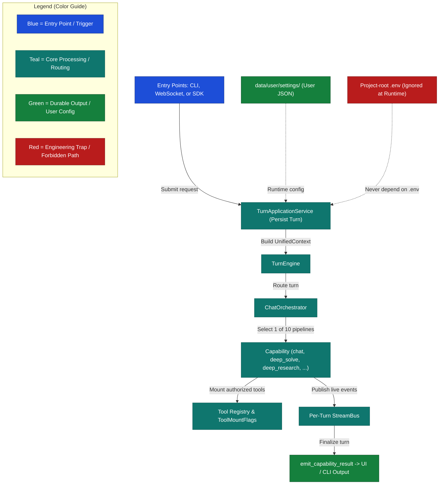
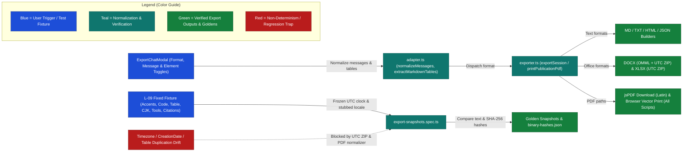
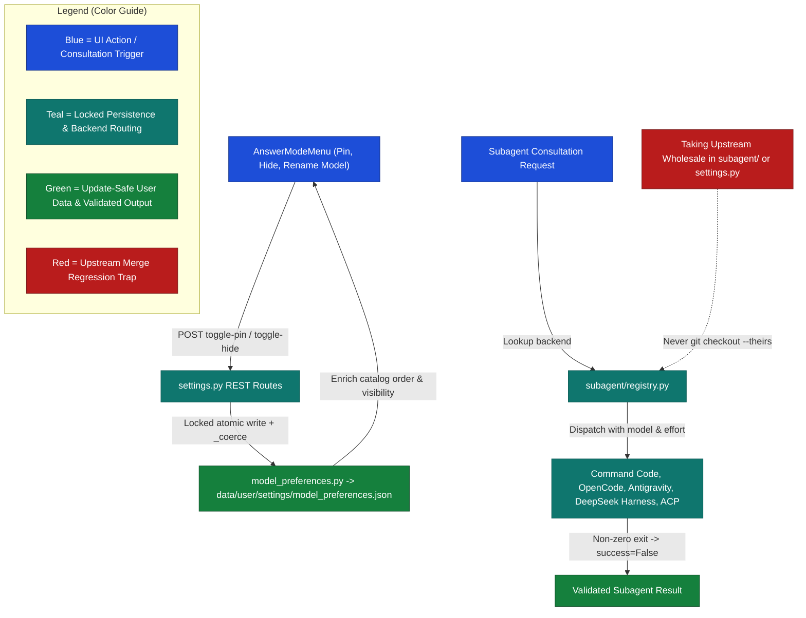
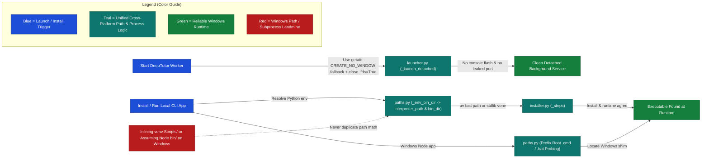
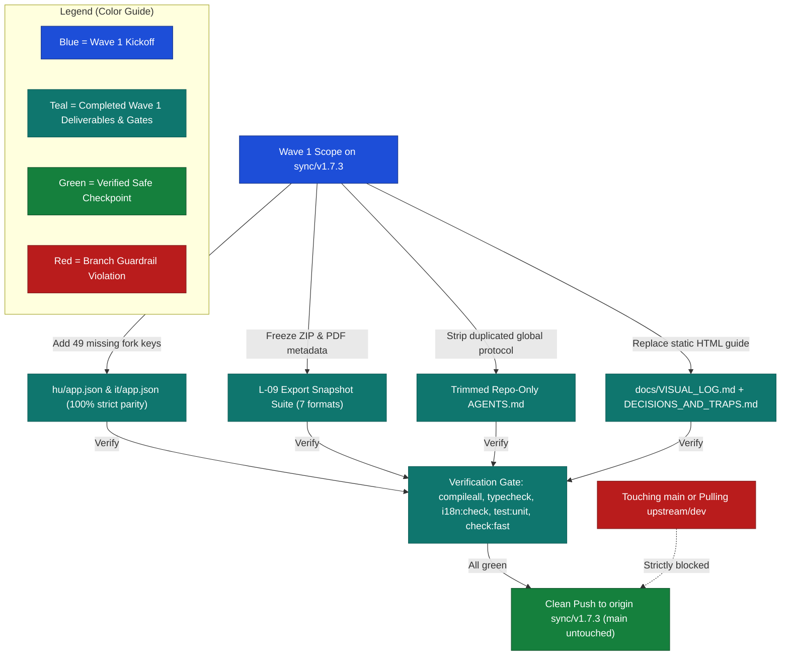

# Visual Feature & Change Log (`VISUAL_LOG.md`)
> **1-Line Summary:** Obsidian- and GitHub-compatible color-coded Mermaid flowcharts documenting DeepTutor's core architecture, custom fork subsystems, and Wave 1 safety-net upgrades.

---

### [VISUAL: Durable-Turn-Execution-Pipeline] | Aliases: turn engine, chat orchestrator, capabilities, stream bus, core architecture
> **1-Line Summary:** Shows how CLI, WebSocket, and SDK requests flow through one durable turn service, route to a single capability, mount tools, and stream results back.

* **Plain-English Walkthrough:** Whether a learner starts a turn from the web UI, the CLI, or the SDK, the request lands in `TurnApplicationService`, which saves the turn before execution begins. `TurnEngine` hands a `UnifiedContext` to `ChatOrchestrator`, which picks one turn-owning capability. That capability mounts only the tools allowed by user toggles and context flags, streams progress over `StreamBus`, and closes the turn through `emit_capability_result`. All runtime configuration is read from `data/user/settings/` rather than a project-root `.env` file.
* **Code Anchors (Grep Targets):**
  * `deeptutor_cli/main.py` -> CLI entry points
  * `deeptutor/api/routers/unified_ws.py` -> WebSocket turn entry
  * `deeptutor/app/service.py` -> `TurnApplicationService`
  * `deeptutor/agents/_shared/tool_composition.py` -> `ToolMountFlags`
  * `deeptutor/tools/builtin/__init__.py` -> `USER_TOGGLEABLE_TOOL_NAMES`, `CONFIGURABLE_BUILTIN_TOOL_NAMES`
  * `deeptutor/services/config/runtime_settings.py` -> runtime settings loader

---

### [VISUAL: Multi-Format-Browser-Export-And-Snapshot-Guard] | Aliases: export engine, docx, xlsx, pdf, omml, L-09, export snapshots, deterministic tests
> **1-Line Summary:** Traces browser-side seven-format conversation export and the L-09 deterministic golden snapshot harness that guards future library migrations.

* **Plain-English Walkthrough:** Everything exports locally in the browser with no backend document service. `ExportChatModal` passes selected messages and element toggles into `adapter.ts`, which extracts Markdown tables once (preventing duplicate tables) and hands normalized messages to `exporter.ts`. The L-09 snapshot suite runs all seven formats against a fixed multi-element fixture with frozen UTC timestamps, verifying exact text goldens, OMML math accents, CJK preservation, numeric Excel cells, and stable SHA-256 binary hashes before any Wave 3 library migration begins.
* **Code Anchors (Grep Targets):**
  * `web/features/export/ExportChatModal.tsx` -> `ExportChatModal`, `NON_LATIN_SCRIPT`
  * `web/lib/export/adapter.ts` -> `normalizeMessages`, `extractMarkdownTables`
  * `web/lib/export/exporter.ts` -> `exportSession`, `printPublicationPdf`, `assertExportSize`
  * `web/lib/export/zip.ts` -> `getDosDateTime`, `createZipBlob`
  * `web/lib/export/docx-builder.ts` -> `buildDocxBlob`
  * `web/lib/export/xlsx-builder.ts` -> `buildXlsxBlob`
  * `web/lib/export/omml.ts` -> OMML accent and stacked-limit conversion
  * `web/tests/fixtures/export/conversation.fixture.ts` -> `FIXED_EXPORT_DATE`, `EXPORT_FIXTURE_MESSAGES`
  * `web/tests/lib/export-snapshots.spec.ts` -> deterministic golden snapshot assertions

---

### [VISUAL: Subagent-Backends-And-Model-Preferences] | Aliases: subagent, command code, opencode, antigravity, deepseek harness, pin model, hide model
> **1-Line Summary:** Shows how user-owned model preferences customize the picker while subagent backends dispatch turns to external CLI harnesses safely.

* **Plain-English Walkthrough:** Learners customize model display names, star-pinned favorites, and hidden models directly from `AnswerModeMenu`. Mutations pass through FastAPI routes into `model_preferences.py`, which uses a write lock, shape validation (`_coerce`), and unique temp files to update `data/user/settings/model_preferences.json` safely across upstream updates. Separately, `subagent/registry.py` routes external CLI consultations to Command Code, OpenCode, Antigravity, DeepSeek Harness, or ACP backends and guarantees that non-zero exit codes are always surfaced as failures.
* **Code Anchors (Grep Targets):**
  * `deeptutor/services/subagent/model_preferences.py` -> `load_model_preferences`, `_coerce`, `_WRITE_LOCK`
  * `deeptutor/api/routers/settings.py` -> model-preference toggle endpoints
  * `web/components/chat/home/AnswerModeMenu.tsx` -> `ModelPreferenceActions`
  * `deeptutor/services/subagent/registry.py` -> subagent backend registry
  * `deeptutor/services/subagent/command_code.py` -> `consult`, `_EFFORT_ALIASES`

---

### [VISUAL: Windows-Launcher-And-CLI-Apps-Runtime] | Aliases: windows launcher, CREATE_NO_WINDOW, cli apps, uv, venv, npm cmd, _env_bin_dir
> **1-Line Summary:** Explains how DeepTutor launches detached workers on Windows without console flashes and resolves Python and Node CLI app executables consistently.

* **Plain-English Walkthrough:** On Windows, spawning background workers can flash empty terminal windows or leak listening ports if file descriptors stay open, and stripped Python builds can lack `subprocess.CREATE_NO_WINDOW`. `launcher.py` uses a safe `getattr` fallback with `close_fds=True`. For local CLI apps, both Python installation (`installer.py`) and runtime lookup (`paths.py`) share `_env_bin_dir()`, while Windows Node packages probe the npm prefix root for `.cmd` and `.bat` shims instead of POSIX `bin/`.
* **Code Anchors (Grep Targets):**
  * `deeptutor/runtime/launcher.py` -> `_launch_detached`
  * `deeptutor/services/cli_apps/paths.py` -> `_env_bin_dir`, `interpreter_path`, `bin_dir`, `executable_path`
  * `deeptutor/services/cli_apps/installer.py` -> `_steps`

---

### [VISUAL: Wave-1-Locale-Parity-And-Protocol-Alignment] | Aliases: wave 1, hu locale, it locale, i18n check, agents trim, visual log migration
> **1-Line Summary:** Summarizes the Wave 1 sync and protocol cleanup that closed all 49 Hungarian/Italian i18n gaps, established L-09 export goldens, trimmed `AGENTS.md`, and migrated visual docs to Markdown.

* **Plain-English Walkthrough:** Wave 1 establishes a verified safety net on `sync/v1.7.3` before larger Wave 2 (Model & Harness Manager) and Wave 3 (Export Overhaul) refactors begin. Hungarian and Italian catalogs now match English 100% in strict audit mode, all seven export formats have deterministic golden snapshots, root `AGENTS.md` contains only DeepTutor-specific facts, and `docs/VISUAL_GUIDE.html` has been retired in favor of this Markdown-native `docs/VISUAL_LOG.md`.
* **Code Anchors (Grep Targets):**
  * `web/locales/hu/app.json` -> Hungarian fork export and model preference translations
  * `web/locales/it/app.json` -> Italian fork export and model preference translations
  * `web/tests/lib/export-snapshots.spec.ts` -> L-09 snapshot suite
  * `AGENTS.md` -> trimmed repository-specific instructions
  * `docs/VISUAL_LOG.md` -> Markdown-native visual feature and change log
  * `docs/DECISIONS_AND_TRAPS.md` -> `[DECISION: Deterministic-Export-Snapshots-And-Markdown-Visual-Log]`
